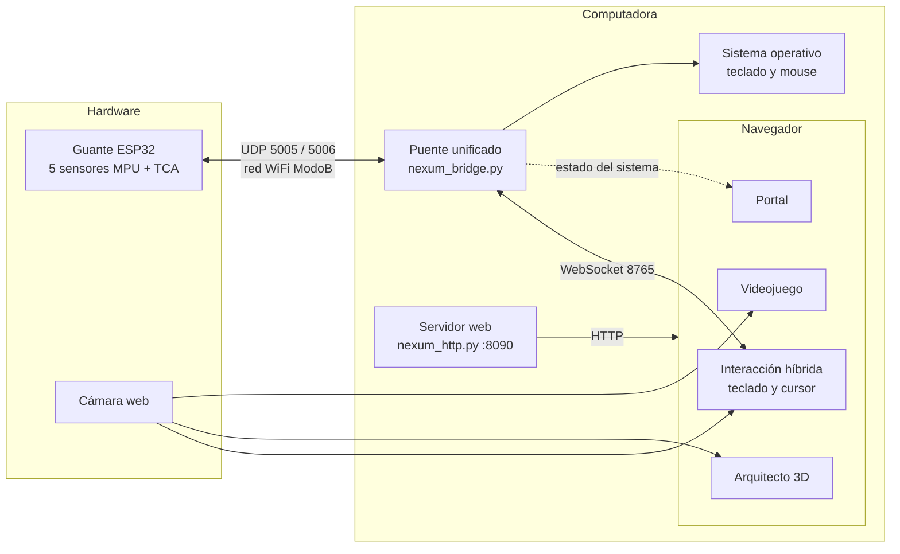
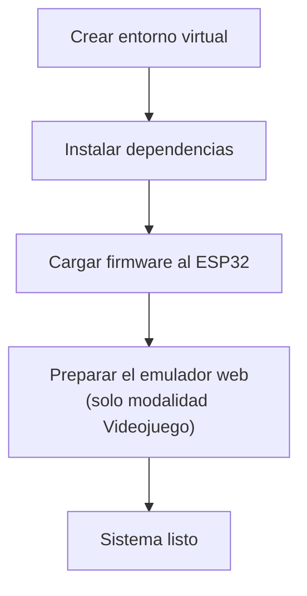
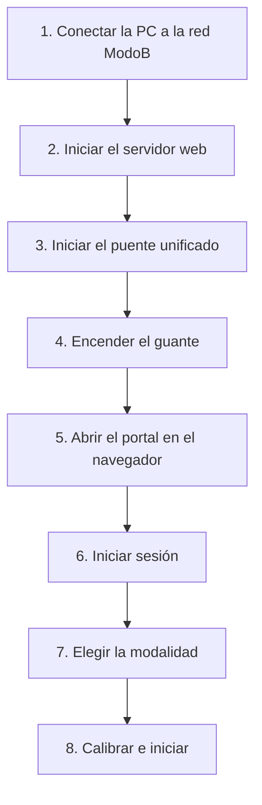
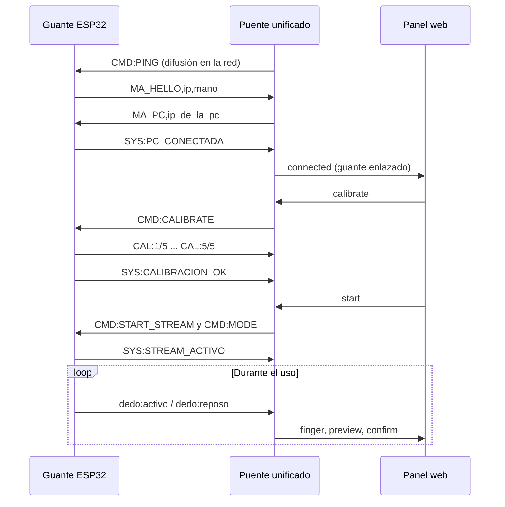
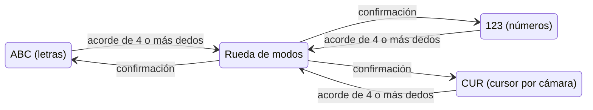
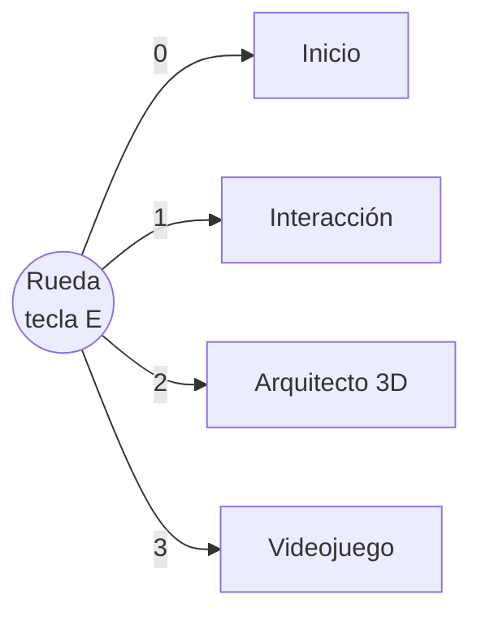
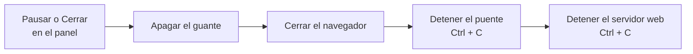

# NEXUM AI — Guía de ejecución del sistema

Esta guía describe, en orden, el procedimiento para poner en marcha NEXUM AI: preparación del entorno, arranque de los servicios, emparejamiento del guante y uso de las tres modalidades de interacción.

---

## Contenido

1. [Arquitectura general](#1-arquitectura-general)
2. [Requisitos](#2-requisitos)
3. [Preparación inicial (una sola vez)](#3-preparación-inicial-una-sola-vez)
4. [Orden de arranque](#4-orden-de-arranque)
5. [Emparejamiento y calibración del guante](#5-emparejamiento-y-calibración-del-guante)
6. [Uso de las modalidades](#6-uso-de-las-modalidades)
7. [Navegación entre módulos](#7-navegación-entre-módulos)
8. [Apagado del sistema](#8-apagado-del-sistema)
9. [Solución de problemas](#9-solución-de-problemas)
10. [Referencia rápida](#10-referencia-rápida)

---

## 1. Arquitectura general

NEXUM AI se compone de cuatro elementos que trabajan en conjunto: el guante con sensores (ESP32), el puente unificado en Python, el servidor web local y los paneles que se ejecutan en el navegador.



El guante se utiliza desde el panel de **Interacción híbrida**, donde también se calibra. Los paneles de **Arquitecto 3D** y **Videojuego** se controlan con la cámara, mediante visión artificial que se ejecuta en el navegador.

| Componente | Archivo | Función |
|---|---|---|
| Firmware del guante | `modulo_teclado/hardware-firdware/ManuelAssistGlove/` | Lee la flexión de cada dedo y la envía por UDP |
| Puente unificado | `scripts/nexum_bridge.py` | Recibe los datos del guante, los interpreta y los distribuye a los paneles |
| Servidor web | `scripts/nexum_http.py` | Sirve el portal, los paneles y la API de autenticación |
| Portal | `index.html` | Inicio de sesión y acceso a los módulos |
| Interacción híbrida | `modulo_teclado/laboratorio-web/` | Escritura con el guante y control del cursor con la cámara |
| Arquitecto 3D | `modulo_arquitecto/panel/` | Edición de escenas tridimensionales mediante gestos |
| Videojuego | `modulo_game/panel/` | Control de juegos Neo Geo con cámara y guante |

---

## 2. Requisitos

### 2.1 Hardware

| Elemento | Especificación |
|---|---|
| Computadora | Windows 10 u 11, 8 GB de RAM como mínimo |
| Guante NEXUM | ESP32 con multiplexor TCA9548A y cinco sensores MPU |
| Cámara web | Integrada o USB, 720p recomendado |
| Red WiFi | Punto de acceso con nombre `ModoB` |
| Cable USB | Solo para cargar el firmware al ESP32 |

### 2.2 Software

| Herramienta | Versión | Uso |
|---|---|---|
| Python | 3.10 | Puente y servidor web |
| Navegador | Chrome o Edge actualizado | Paneles y visión por cámara |
| Arduino IDE | 2.x con el paquete de placas `esp32` | Carga del firmware |

### 2.3 Conectividad

- La computadora y el guante deben estar conectados a la misma red WiFi `ModoB`.
- Los paneles descargan Three.js y MediaPipe desde CDN, por lo que la red debe tener acceso a Internet.

---

## 3. Preparación inicial (una sola vez)

Estos pasos se realizan solo la primera vez que se instala el sistema en una computadora.



### 3.1 Crear el entorno virtual e instalar dependencias

Abrir una terminal en la carpeta raíz del proyecto (`NEXUM_AI`) y ejecutar:

**PowerShell**

```powershell
python -m venv .venv
.\.venv\Scripts\Activate.ps1
python -m pip install --upgrade pip
pip install -r requirements.txt
```

**Git Bash**

```bash
python -m venv .venv
source .venv/Scripts/activate
python -m pip install --upgrade pip
pip install -r requirements.txt
```

### 3.2 Cargar el firmware al guante

1. Abrir Arduino IDE.
2. Abrir el archivo `modulo_teclado/hardware-firdware/ManuelAssistGlove/ManuelAssistGlove.ino`.
3. Verificar en las primeras líneas que `WIFI_SSID` y `WIFI_PASS` correspondan a la red `ModoB`.
4. Seleccionar la placa **ESP32 Dev Module** y el puerto COM correspondiente.
5. Presionar **Subir** y esperar el mensaje de carga completada.
6. Desconectar el cable USB y alimentar el guante con su batería.

### 3.3 Preparar el emulador web (modalidad Videojuego)

Este paso solo es necesario si las carpetas `modulo_game/panel/ejs/cores/` o `modulo_game/panel/web-roms/` no existen.

```bash
python modulo_game/scripts/download_ejs.py
python modulo_game/scripts/prepare_web_roms.py
```

El primer comando descarga el emulador y sus núcleos. El segundo convierte las ROM ubicadas en `modulo_game/gameNeogeo/NeoRAGEx 5.2a/ROMs/` al formato que usa el navegador.

---

## 4. Orden de arranque

Cada vez que se utilice el sistema, el arranque debe seguir este orden. Respetarlo garantiza que el guante encuentre al puente y que los paneles se conecten correctamente.



### Paso 1. Conectar la computadora a la red

Conectar la computadora a la red WiFi `ModoB`. Es la misma red a la que se conecta el guante.

### Paso 2. Iniciar el servidor web

En una primera terminal, desde la raíz del proyecto:

```bash
.venv/Scripts/python.exe -u scripts/nexum_http.py
```

Resultado esperado:

```text
NEXUM HTTP http://127.0.0.1:8090/  (COOP/COEP solo emulador)
Auth DB: ...\project\database\runtime\usuarios.json
```

### Paso 3. Iniciar el puente unificado

En una segunda terminal, desde la raíz del proyecto:

```bash
.venv/Scripts/python.exe -u scripts/nexum_bridge.py
```

Resultado esperado:

```text
NEXUM Bridge unificado
UDP guante: 5005
Laboratorio: ws://127.0.0.1:8765
Juego:       ws://127.0.0.1:8766
Arquitecto:  ws://127.0.0.1:8767
[UDP] escuchando 0.0.0.0:5005
[UDP] buscar ESP32 (bridge_start, hard=True)
```

> Ambas terminales deben permanecer abiertas mientras se use el sistema. Solo puede haber un puente en ejecución, porque el puerto UDP 5005 es exclusivo.

### Paso 4. Encender el guante

Encender el guante. En pocos segundos se conecta a la red y saluda al puente. En la terminal del puente aparecen estas líneas:

```text
[UDP RX] 192.168.x.x -> MA_HELLO,...
[UDP RX] 192.168.x.x -> SYS:PC_CONECTADA
[GLOVE] guante enlazado: 192.168.x.x
```

### Paso 5. Abrir el portal

Abrir el navegador en la siguiente dirección:

```text
http://127.0.0.1:8090/
```

> Se debe usar siempre esta dirección. Si se abren los archivos HTML con doble clic, los paneles no podrán acceder a la cámara ni al puente.

### Paso 6. Iniciar sesión

Presionar **Iniciar sesion** en la esquina superior. La primera vez, crear un usuario en la pestaña **Crear cuenta**. Las cuentas se guardan localmente en `project/database/runtime/usuarios.json`.

El portal muestra un indicador de estado que confirma que el servidor, el puente, el guante y la cámara están disponibles.

### Paso 7. Elegir la modalidad

Desde el portal, seleccionar una de las tres modalidades: **Interacción**, **Arquitecto 3D** o **Videojuego**.

### Paso 8. Calibrar e iniciar

Para usar el guante, abrir la modalidad **Interacción** y seguir el procedimiento de la sección siguiente. Las modalidades **Arquitecto 3D** y **Videojuego** solo requieren activar la cámara, como se describe en la sección 6.

---

## 5. Emparejamiento y calibración del guante

### 5.1 Secuencia de emparejamiento

El emparejamiento ocurre automáticamente al encender el guante con el puente ya en ejecución.



### 5.2 Calibración

1. Abrir el panel de **Interacción** y presionar **Conectar puente** si el panel no lo hizo automáticamente.
2. Verificar que el indicador de conexión muestre el guante como enlazado.
3. Presionar **Calibrar**.
4. Mantener la mano relajada y extendida mientras la barra avanza de 0 % a 100 %.
5. Al llegar al 100 %, el guante queda calibrado y no es necesario repetir el proceso mientras siga encendido.

### 5.3 Inicio de la transmisión

Presionar **Iniciar**. A partir de ese momento, cada flexión de un dedo se refleja en el panel y se convierte en una acción.

| Botón | Efecto |
|---|---|
| **Conectar puente** | Establece la conexión entre el panel y el puente |
| **Calibrar** | Registra la posición de reposo de cada dedo |
| **Iniciar** | Activa el envío continuo de datos desde el guante |
| **Pausar** | Detiene el envío sin desconectar el guante |
| **Cerrar** | Desconecta el guante del puente |

---

## 6. Uso de las modalidades

### 6.1 Interacción híbrida (teclado y cursor)

El panel funciona en tres modos: letras (**ABC**), números (**123**) y cursor (**CUR**).



**Escritura con el guante (ABC y 123)**

Cada dedo tiene asignado un grupo de caracteres. Los toques repetidos con el mismo dedo recorren el grupo, y el carácter se escribe automáticamente 2.5 segundos después del último toque.

| Dedo | Letras (ABC) | Números (123) |
|---|---|---|
| Pulgar | a b c d e f | 1 2 + |
| Índice | g h i j k l | 3 4 - |
| Medio | m n ñ o p | 5 6 * |
| Anular | q r s t u | 7 8 / |
| Meñique | v w x y z | 9 0 . ; |

**Cambio de modo**

1. Levantar cuatro o más dedos casi a la vez para abrir la rueda de modos.
2. Bajar la mano. Cada toque posterior avanza a la siguiente opción.
3. La opción seleccionada se confirma sola tras dos segundos sin tocar, o al repetir el acorde de cuatro dedos.

**Modo cursor (CUR)**

En este modo, el puntero del sistema se controla con la cámara.

| Gesto ante la cámara | Acción |
|---|---|
| Mover la mano derecha | Desplazar el puntero |
| Levantar solo el meñique | Clic izquierdo |
| Levantar solo el pulgar | Clic derecho |
| Mano izquierda completamente abierta, sostenida | Tecla Windows |
| Puño | Borrar; si se mantiene, borra de forma continua |

> Solo un panel puede usar la cámara a la vez. Al activarla en un módulo, los demás la liberan automáticamente.

### 6.2 Arquitecto 3D

1. Presionar **Activar camara**.
2. Colocarse frente a la cámara, con ambas manos visibles.
3. Usar los gestos para seleccionar, mover, rotar, escalar y duplicar módulos de la escena.
4. Alternar entre los modos **Edicion**, **Navegacion** y **Vista previa** según la tarea.
5. Usar **Guardar**, **Cargar**, **Exportar JSON** e **Importar JSON** para conservar el trabajo.

### 6.3 Videojuego

1. Elegir un juego del catálogo, filtrando por **Acción**, **Pelea** o **Naves** si se desea, y presionar **Jugar**.
2. Presionar **Activar cámara**.
3. Colocarse frente a la cámara con ambas manos visibles.

| Gesto ante la cámara | Acción en el juego |
|---|---|
| Índice izquierdo hacia un costado | Movimiento izquierda o derecha |
| Puño de la mano izquierda | Start |
| Mano derecha abierta | Disparo |
| Puño de la mano derecha | Salto |
| Mano derecha apuntando hacia abajo | Agacharse |

El panel también ofrece botones en pantalla para las direcciones y las acciones.

---

## 7. Navegación entre módulos

Todos los paneles comparten una rueda de navegación.

| Acción | Resultado |
|---|---|
| Mantener la tecla **E** | Abrir la rueda; al soltarla se navega a la opción resaltada |
| Teclas **0**, **1**, **2**, **3** con la rueda abierta | Inicio, Interacción, Arquitecto 3D, Videojuego |
| Flechas y **Enter** | Seleccionar y confirmar |
| **Escape** | Cerrar la rueda sin cambiar de módulo |



---

## 8. Apagado del sistema

El apagado sigue el orden inverso al arranque.



---

## 9. Solución de problemas

| Síntoma | Causa probable | Solución |
|---|---|---|
| `puerto 5005 ocupado` al iniciar el puente | Ya hay otro puente en ejecución | Cerrar la otra terminal del puente o finalizar el proceso `python.exe` correspondiente |
| El guante no aparece como enlazado | El guante o la PC no están en la red `ModoB` | Verificar la red de ambos y reiniciar el guante con el puente ya iniciado |
| Mensaje "Otro ESP32 intenta emparejarse" | Hay un segundo guante encendido | Apagar el guante que no se utiliza |
| La barra de calibración no avanza | Se perdió la conexión durante la calibración | Esperar unos segundos, presionar **Cerrar** y volver a **Calibrar** |
| El panel de Interacción no se conecta al puente | El puente no está en ejecución | Iniciar `nexum_bridge.py`, recargar la página y presionar **Conectar puente** |
| La cámara no se activa | Otro panel o programa está usando la cámara | Cerrar las demás pestañas o aplicaciones que la usan y conceder el permiso en el navegador |
| Los modelos 3D o la visión no cargan | No hay acceso a Internet | Conectar una red con salida a Internet para descargar Three.js y MediaPipe |
| El emulador muestra una pantalla negra | Faltan los núcleos o las ROM web | Ejecutar los scripts de la sección 3.3 |

---

## 10. Referencia rápida

### Comandos

| Acción | Comando |
|---|---|
| Iniciar servidor web | `.venv/Scripts/python.exe -u scripts/nexum_http.py` |
| Iniciar puente | `.venv/Scripts/python.exe -u scripts/nexum_bridge.py` |
| Abrir el portal | `http://127.0.0.1:8090/` |

### Puertos

| Puerto | Protocolo | Uso |
|---|---|---|
| 8090 | HTTP | Portal, paneles y API de autenticación |
| 5005 | UDP | Guante hacia la PC |
| 5006 | UDP | PC hacia el guante |
| 8765 | WebSocket | Panel de interacción híbrida y estado del portal |
| 8766 | WebSocket | Canal del módulo de videojuego |
| 8767 | WebSocket | Canal del módulo Arquitecto 3D |

### Direcciones de los paneles

| Módulo | Dirección |
|---|---|
| Portal | `http://127.0.0.1:8090/` |
| Interacción híbrida | `http://127.0.0.1:8090/modulo_teclado/laboratorio-web/` |
| Arquitecto 3D | `http://127.0.0.1:8090/modulo_arquitecto/panel/` |
| Videojuego | `http://127.0.0.1:8090/modulo_game/panel/` |
